<div align="center">

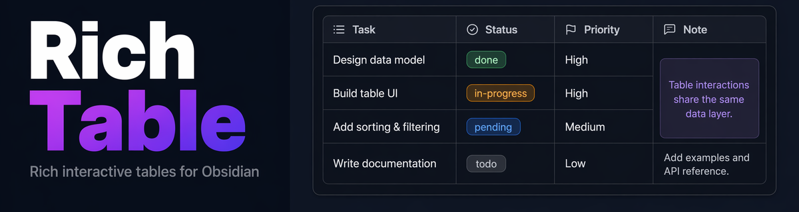

<p>
  <b>🔀 合并单元格 &nbsp;·&nbsp; 🏷️ 类型列 &nbsp;·&nbsp; 🎨 样式设置 &nbsp;·&nbsp; 🧊 冻结行列 &nbsp;·&nbsp; 🔽 排序筛选 &nbsp;·&nbsp; Σ 统计行 &nbsp;·&nbsp; 📑 多表工作簿 &nbsp;·&nbsp; 🗂️ 看板 &nbsp;·&nbsp; 📅 日历 &nbsp;·&nbsp; 🔗 双链补全 &nbsp;·&nbsp; 📐 数学公式</b>
</p>

<p>
  <a href="https://github.com/SdKay/obsidian-rich-table/releases/latest">
    
  </a>
  <a href="https://github.com/SdKay/obsidian-rich-table/releases">
    
  </a>
  <a href="LICENSE">
    
  </a>
  <a href="https://obsidian.md/plugins?id=rich-table">
    
  </a>
  <a href="https://paypal.me/ssdking">
    
  </a>
</p>

<p>
  <a href="#安装">安装</a> ·
  <a href="#功能演示">演示</a> ·
  <a href="#键盘操作">键盘操作</a> ·
  <a href="#设置">设置</a> ·
  <a href="#格式说明">格式</a> ·
  <a href="#导出为-xlsx">导出为 .xlsx</a> ·
  <a href="#外部-xlsx">外部 .xlsx</a> ·
  <a href="README.md">English</a>
</p>

<p>
  
  <br/><sub>扫码关注公众号，获取更多 Obsidian 插件与效率工具资讯</sub>
</p>

<table>
  <thead>
    <tr><th colspan="3">我开发的其他插件</th></tr>
    <tr><th>插件</th><th>简介</th><th>Obsidian 安装页</th></tr>
  </thead>
  <tbody>
    <tr>
      <td><a href="https://github.com/SdKay/obsidian-rich-view"><b>Rich View</b></a></td>
      <td>在笔记中直接显示 draw.io、Visio、PowerPoint</td>
      <td><a href="obsidian://show-plugin?id=rich-view">在 Obsidian 中打开</a></td>
    </tr>
    <tr>
      <td><a href="https://github.com/SdKay/obsidian-rich-search"><b>Rich Search</b></a></td>
      <td>
        <b>搜索能力：</b>范围、正则、全词、大小写、历史记录<br/>
        <b>跨文件联动：</b>联动 Rich View、Rich Table，跨文件搜索
      </td>
      <td><a href="obsidian://show-plugin?id=rich-search">在 Obsidian 中打开</a></td>
    </tr>
  </tbody>
</table>

</div>

---

> **仅限 Obsidian 使用。** `rich-table` 围栏代码块由插件渲染，在标准 Markdown 编辑器或 GitHub 预览中无法显示。

为 Obsidian 打造的富交互表格插件——支持单元格合并、内联编辑、双链自动补全、类型列、数学公式、列表、图片、拖拽排序等功能。

<div align="center">
<p>
  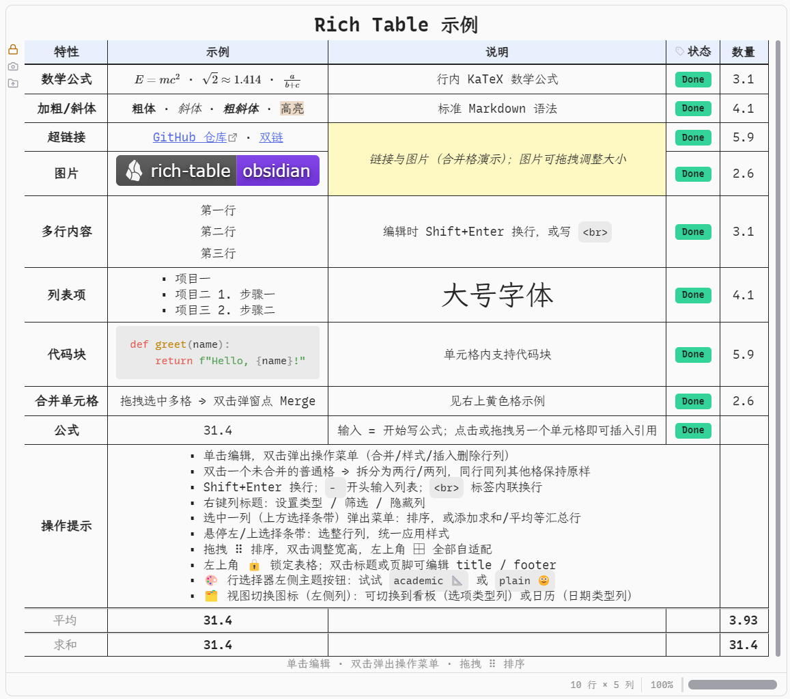
</p>
</div>

---

## 为什么选择 Rich Table？

与 Obsidian 原生 Markdown 表格、以及其他几款社区表格插件（含维护状态各异的项目）的详细对比。评估基于 2026-09 各仓库的公开 README/文档，具体功能可能随版本更新变化。

图例：🟢 完全支持　🔴 不支持　🟡 部分支持 / 有限制

<table>
<thead>
<tr>
<th colspan="2">维度</th>
<th><a href="https://github.com/SdKay/obsidian-rich-table">Rich Table</a></th>
<th><a href="https://www.markdownguide.org/extended-syntax/#tables">原生 Markdown 表格</a></th>
<th><a href="https://github.com/tgrosinger/advanced-tables-obsidian">Advanced Tables</a></th>
<th><a href="https://github.com/aidenlx/table-extended">Table Extended</a></th>
<th><a href="https://github.com/niconekoru/obsidan-advanced-table-xt">Advanced Table XT</a></th>
<th><a href="https://github.com/pistacchio/obsidian-enhanced-tables">Enhanced Tables</a></th>
<th><a href="https://github.com/moranrs/table-master">Table Master</a></th>
<th><a href="https://github.com/yaye-work/obsidian-better-tables">Better Tables</a></th>
<th><a href="https://github.com/maniarasan-zuper/smart-table">Smart Table</a></th>
</tr>
</thead>
<tbody>

<tr><td rowspan="2"><b>数据格式与存储</b></td><td>数据载体</td><td>YAML 代码块</td><td>MD 原生</td><td>MD 原生</td><td>MD（MMD6）</td><td>MD 原生</td><td>MD + YAML config</td><td>MD 原生</td><td>MD + 隐藏注释</td><td>JSON 代码块</td></tr>
<tr><td>Obsidian外使用？</td><td>🔴</td><td>🟢</td><td>🟢</td><td>🟢</td><td>🟢</td><td>🟢</td><td>🟢</td><td>🟡</td><td>🔴</td></tr>

<tr><td rowspan="7"><b>单元格内容能力</b></td><td>单元格内联点击编辑</td><td>🟢</td><td>🔴</td><td>🟢</td><td>🔴</td><td>🔴</td><td>🟡</td><td>🟢</td><td>🟢</td><td>🟢</td></tr>
<tr><td>富文本（粗体/链接/图片等）</td><td>🟢</td><td>🟢</td><td>🟢</td><td>🟢</td><td>🟢</td><td>🟡</td><td>🟢</td><td>🟡</td><td>🔴</td></tr>
<tr><td>cell 内 list</td><td>🟢</td><td>🔴</td><td>🔴</td><td>🟢</td><td>🟢</td><td>🟡</td><td>🟢</td><td>🔴</td><td>🔴</td></tr>
<tr><td>双链自动补全</td><td>🟢</td><td>🔴</td><td>🔴</td><td>🔴</td><td>🔴</td><td>🔴</td><td>🔴</td><td>🟡</td><td>🔴</td></tr>
<tr><td>LaTeX 数学公式</td><td>🟢</td><td>🔴</td><td>🔴</td><td>🔴</td><td>🔴</td><td>🔴</td><td>🔴</td><td>🔴</td><td>🔴</td></tr>
<tr><td>多行内容</td><td>🟢</td><td>🔴</td><td>🔴</td><td>🟢</td><td>🔴</td><td>🔴</td><td>🟢</td><td>🟢</td><td>🔴</td></tr>
<tr><td><b>类型化列（状态/优先级/日期…）</b></td><td>🟢</td><td>🔴</td><td>🔴</td><td>🔴</td><td>🔴</td><td>🟢</td><td>🔴</td><td>🔴</td><td>🟢</td></tr>

<tr><td rowspan="6"><b>结构编辑</b></td><td><b>单元格合并 / 拆分</b></td><td>🟢</td><td>🔴</td><td>🔴</td><td>🟢</td><td>🟢</td><td>🔴</td><td>🟢</td><td>🔴</td><td>🔴</td></tr>
<tr><td><b>拖拽调整列宽/行高</b></td><td>🟢</td><td>🔴</td><td>🔴</td><td>🔴</td><td>🔴</td><td>🔴</td><td>🔴</td><td>🟢</td><td>🟢</td></tr>
<tr><td><b>自动调整行高列宽</b></td><td>🟢</td><td>🔴</td><td>🔴</td><td>🔴</td><td>🔴</td><td>🔴</td><td>🔴</td><td>🔴</td><td>🔴</td></tr>
<tr><td><b>拖拽排序行/列</b></td><td>🟢</td><td>🔴</td><td>🟢</td><td>🔴</td><td>🔴</td><td>🔴</td><td>🟢</td><td>🟢</td><td>🟢</td></tr>
<tr><td>插入/删除/隐藏行列</td><td>🟢</td><td>🟡</td><td>🟢</td><td>🟡</td><td>🟡</td><td>🔴</td><td>🟢</td><td>🟢</td><td>🟢</td></tr>
<tr><td>整表转置（行列互换）</td><td>🟢</td><td>🔴</td><td>🔴</td><td>🔴</td><td>🔴</td><td>🔴</td><td>🔴</td><td>🔴</td><td>🔴</td></tr>

<tr><td rowspan="8"><b>数据操作</b></td><td>排序</td><td>🟢</td><td>🔴</td><td>🟢</td><td>🔴</td><td>🔴</td><td>🟢</td><td>🟢</td><td>🔴</td><td>🟢</td></tr>
<tr><td><b>按值筛选行</b></td><td>🟢</td><td>🔴</td><td>🔴</td><td>🔴</td><td>🔴</td><td>🟢</td><td>🔴</td><td>🔴</td><td>🟢</td></tr>
<tr><td><b>单元格公式</b></td><td>🟢</td><td>🔴</td><td>🟢</td><td>🔴</td><td>🔴</td><td>🟡</td><td>🔴</td><td>🔴</td><td>🔴</td></tr>
<tr><td>汇总 / 统计行</td><td>🟢</td><td>🔴</td><td>🔴</td><td>🔴</td><td>🔴</td><td>🔴</td><td>🔴</td><td>🔴</td><td>🔴</td></tr>
<tr><td>从 Excel / 网页粘贴表格</td><td>🟢</td><td>🔴</td><td>🔴</td><td>🔴</td><td>🔴</td><td>🔴</td><td>🟢</td><td>🔴</td><td>🔴</td></tr>
<tr><td>导出 CSV</td><td>🔴</td><td>🔴</td><td>🟢</td><td>🔴</td><td>🔴</td><td>🔴</td><td>🔴</td><td>🔴</td><td>🟢</td></tr>
<tr><td><b>导出 / 载入 .xlsx</b></td><td>🟢</td><td>🔴</td><td>🔴</td><td>🔴</td><td>🔴</td><td>🔴</td><td>🔴</td><td>🔴</td><td>🔴</td></tr>
<tr><td>嵌套表格</td><td>🟢</td><td>🔴</td><td>🔴</td><td>🔴</td><td>🔴</td><td>🔴</td><td>🔴</td><td>🔴</td><td>🔴</td></tr>

<tr><td rowspan="5"><b>样式与外观</b></td><td>单元格 / 行 / 列自定义样式</td><td>🟢</td><td>🔴</td><td>🔴</td><td>🟡</td><td>🟢</td><td>🟢</td><td>🔴</td><td>🔴</td><td>🔴</td></tr>
<tr><td>内置主题</td><td>🟢</td><td>🔴</td><td>🔴</td><td>🔴</td><td>🔴</td><td>🔴</td><td>🔴</td><td>🔴</td><td>🔴</td></tr>
<tr><td><b>列对齐方式</b></td><td>🟢</td><td>🟢</td><td>🟢</td><td>🟢</td><td>🟢</td><td>🔴</td><td>🟢</td><td>🟢</td><td>🟢</td></tr>
<tr><td><b>表格标题 / 底部备注</b></td><td>🟢</td><td>🔴</td><td>🔴</td><td>🔴</td><td>🔴</td><td>🔴</td><td>🟡</td><td>🔴</td><td>🔴</td></tr>
<tr><td><b>整表缩放</b></td><td>🟢</td><td>🔴</td><td>🔴</td><td>🔴</td><td>🔴</td><td>🔴</td><td>🔴</td><td>🔴</td><td>🔴</td></tr>

<tr><td rowspan="3"><b>交互与可用性</b></td><td>键盘方向键 / Tab / Enter 导航</td><td>🟢</td><td>🔴</td><td>🟢</td><td>🔴</td><td>🔴</td><td>🔴</td><td>🟢</td><td>🟢</td><td>🔴</td></tr>
<tr><td><b>冻结行/列</b></td><td>🟢</td><td>🔴</td><td>🔴</td><td>🔴</td><td>🔴</td><td>🔴</td><td>🔴</td><td>🔴</td><td>🔴</td></tr>
<tr><td>表格锁定</td><td>🟢</td><td>🔴</td><td>🔴</td><td>🔴</td><td>🔴</td><td>🔴</td><td>🔴</td><td>🔴</td><td>🔴</td></tr>

<tr><td rowspan="3"><b>其他特性</b></td><td><b>多 Sheet 工作簿</b></td><td>🟢</td><td>🔴</td><td>🔴</td><td>🔴</td><td>🔴</td><td>🔴</td><td>🔴</td><td>🔴</td><td>🔴</td></tr>
<tr><td>看板（Kanban）/ 日历视图</td><td>🟢</td><td>🔴</td><td>🔴</td><td>🔴</td><td>🔴</td><td>🔴</td><td>🔴</td><td>🔴</td><td>🔴</td></tr>
<tr><td>表格快照导出（PNG/SVG）</td><td>🟢</td><td>🔴</td><td>🔴</td><td>🔴</td><td>🔴</td><td>🔴</td><td>🔴</td><td>🔴</td><td>🔴</td></tr>

</tbody>
</table>

---

## 安装

**推荐 — 社区插件浏览器：**

1. 打开 **设置 → 第三方插件 → 浏览**
2. 搜索 **Rich Table** 并安装
3. 启用插件

或直接跳转：[在 Obsidian 中打开](https://obsidian.md/plugins?id=rich-table)

**手动安装：** 将 `main.js`、`manifest.json`、`styles.css` 复制到 `<vault>/.obsidian/plugins/rich-table/`

最低 Obsidian 版本：**1.8.7**

---

## 功能演示

> **⬆️ 从 v0.x 升级？** — v1 → v2 迁移：旧格式表格的升级提示横幅，一键转换或保持旧格式只读浏览。
>
> 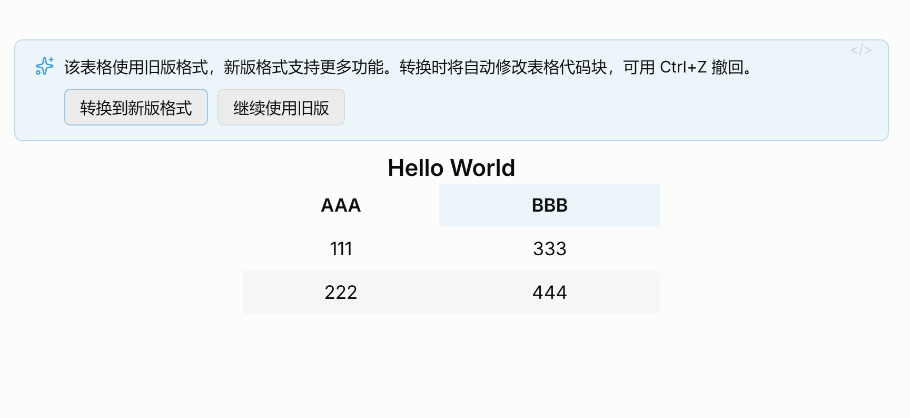


**1 · 模板快速开始 — 或插入空白表格**

手动输入 `` ```rich-table ``，或者不想手打：命令面板里运行**插入 Rich Table**（可在 设置→快捷键 里自己绑定快捷键）、点左侧功能栏图标，或者在编辑器里右键从菜单里选——三种方式都会在光标处插入一个空代码块。

已经有一个普通的 Markdown 表格？把光标放在表格里，从命令面板运行**转为 Rich Table**（同样可以自己绑定快捷键），即可原地转换——表头行变为列名，其余行变为数据。编辑器右键菜单里也有这个选项，但 Live Preview 下直接右键表格本身会被 Obsidian 自带的表格编辑控件拦截，此时切到源码模式右键，或直接用命令面板即可。

空的 `rich-table` 代码块会为每个内置模板显示一个按钮（目前有展示全部功能的**演示表**和**康奈尔笔记**布局），再加上**插入空白表格**，后者会弹出类似 Word/Sheets 的尺寸选择器——鼠标划过 8×6 的网格实时预览、点击确认行列数，也可以直接输入精确数字（超出网格范围时使用）。鼠标悬停任意按钮会在下方实时预览对应内容；不悬停时默认预览第一个模板。模板文件放在 `src/templates/*.yaml` 里自动发现（跟主题系统同一套机制），新增模板不需要改代码。


**2 · 合并单元格** — 拖选 → 弹窗点 Merge


**3 · 类型列 & 样式设置** — 单击切换值，双击设置样式


**4 · 排序 & 行列操作** — 选中多行/多列后长按已选中的选择器并拖动，整块移动、其余行列自动让位；单行/单列也可按住 Ctrl/Cmd 拖拽或按 Alt+Shift+方向键；双击弹出操作菜单


**5 · 拖拽调整宽高** — 拖拽列标题右边缘调整列宽 · 拖拽行底边缘调整行高。只有被拖拽的那一列/行尺寸会变化，表格整体宽高随之增减，行为与 Excel 一致。没有自己宽高的列/行会自动跟随内容（"auto"）；拖拽调整即固定为具体数值，双击调整手柄可清空恢复为 auto


**6 · 标题与底部备注** — 单击内联编辑，Shift+Enter 换行

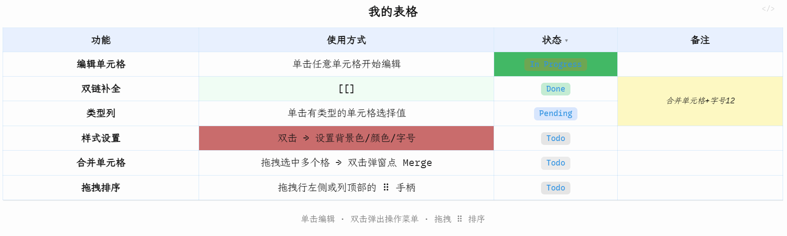

**7 · 列筛选** — 筛选展示表格


**8 · 富内容单元格** — 数学公式 · 加粗/斜体 · 链接 · 图片 · 列表 · 多行

> 🎬 *演示 GIF 即将发布*

**9 · 与 Excel/Markdown 互相复制粘贴** — 从 Excel/Sheets 复制的内容可直接粘贴进单元格（通过剪贴板 HTML 识别），标准 Markdown/GFM 表格（手打、从别的笔记复制、AI 回复、GitHub 等，以纯文本形式粘贴）也能识别并拆分成网格；如果粘贴目标是**表头**格，则会把整张表转成本表格式——粘贴内容的表头行变成列名，其余行变成数据，一次粘贴完成格式转换。也可把选区复制为 Excel 兼容表格或 Markdown 表格，入口在选区/单元格/表头菜单——复制范围内的合并单元格会原样带过去。选中单个格子或多个格子（不需要进入编辑态）时 Ctrl+V 也能直接粘贴，从选区左上角开始写入，并按复制时的合并形状在目标位置重建合并；如果目标位置正好挡着别的合并，会直接吸收掉那个旧合并，不会报错拒绝

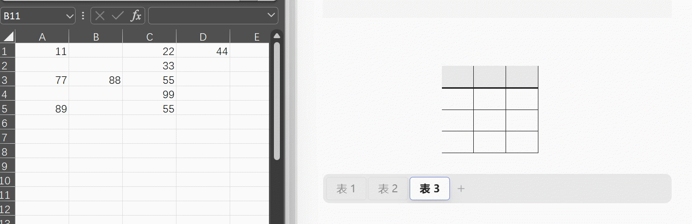

**10 · 行排序** — 列选择器弹出菜单：一次性排序或自动排序（表头常驻提示）

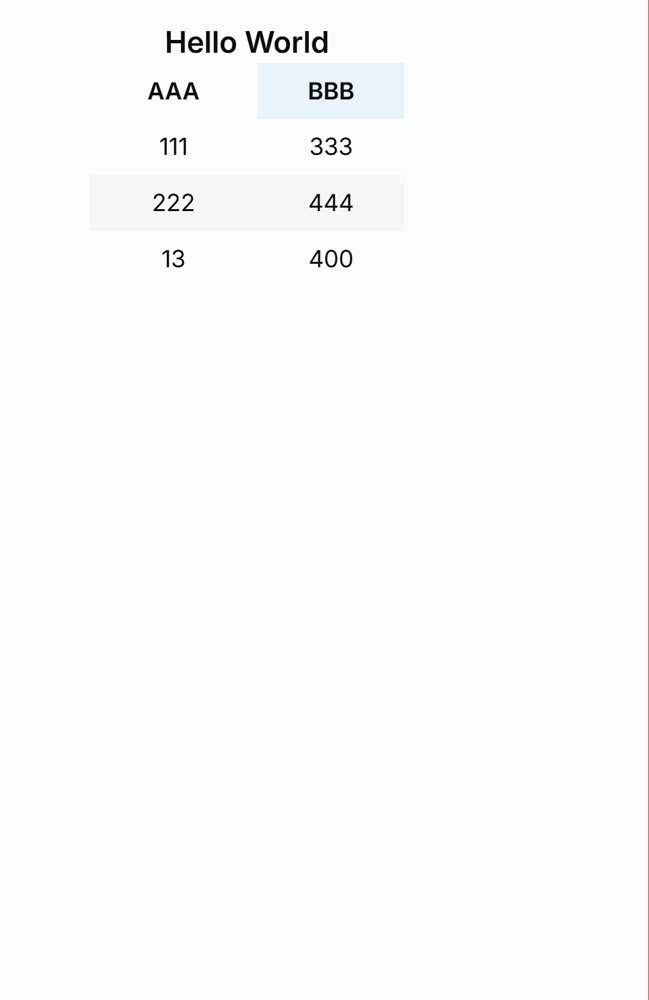

**11 · 汇总行** — 通过 Σ 图标或列选择器弹出菜单开启求和/平均/最小值/最大值/计数；每行可单独删除或拖拽调整顺序

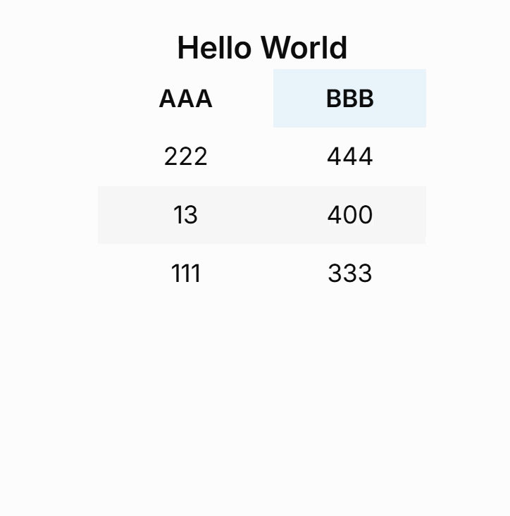

**12 · 表格折叠/展开** — 折叠图标按钮收起/展开表格内容，保留标题和表头可见

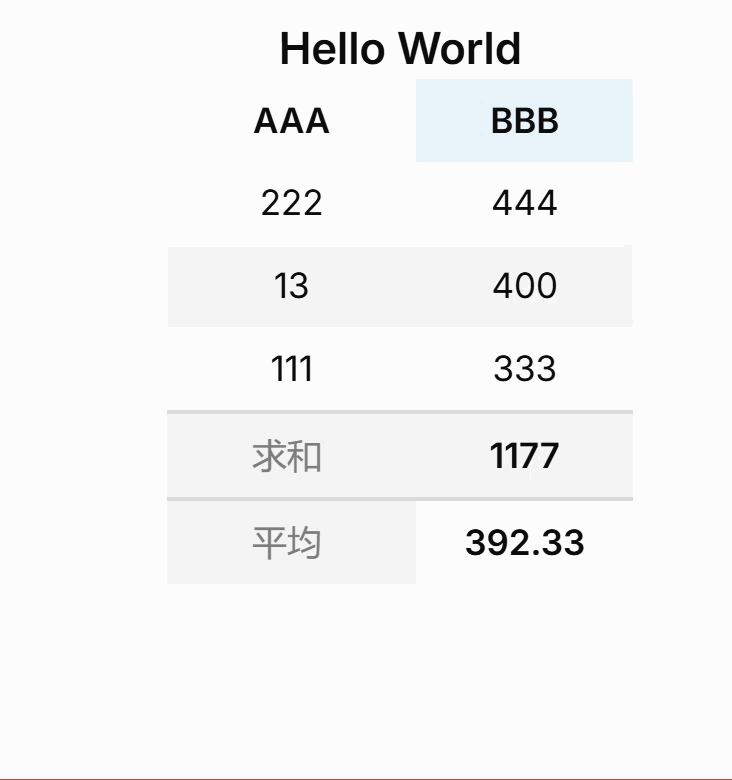

**13 · 表格锁定** — 🔒 图标禁用该表格的全部图形化编辑；单元格文字仍可用鼠标拖拽选中、用浏览器自带的 Ctrl+C 复制，跟普通网页一样

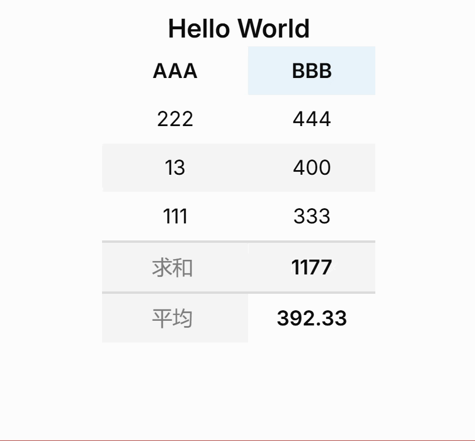

**14 · 一键自适应** — ⊞ 图标把所有列宽和行高清空恢复为 auto，之后持续跟随内容变化，而不是只调整一次后固定住

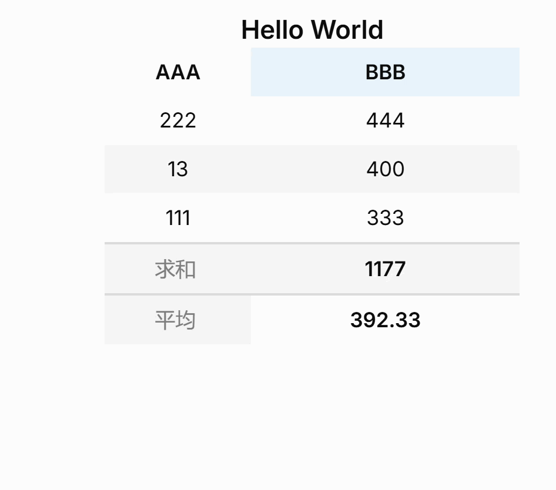

**15 · 主题切换** — 🎨 图标切换内置主题（`academic`、`grid`、`plain`）

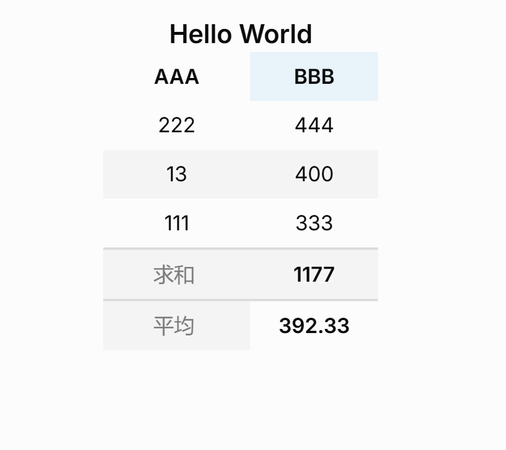

**16 · 拆分单元格** — 双击一个未合并的普通格 → 拆分为两行/两列，同行/列其他格保持原有外形。表头行同样支持拆分，并可向下与数据行合并，入口在同一个面板里

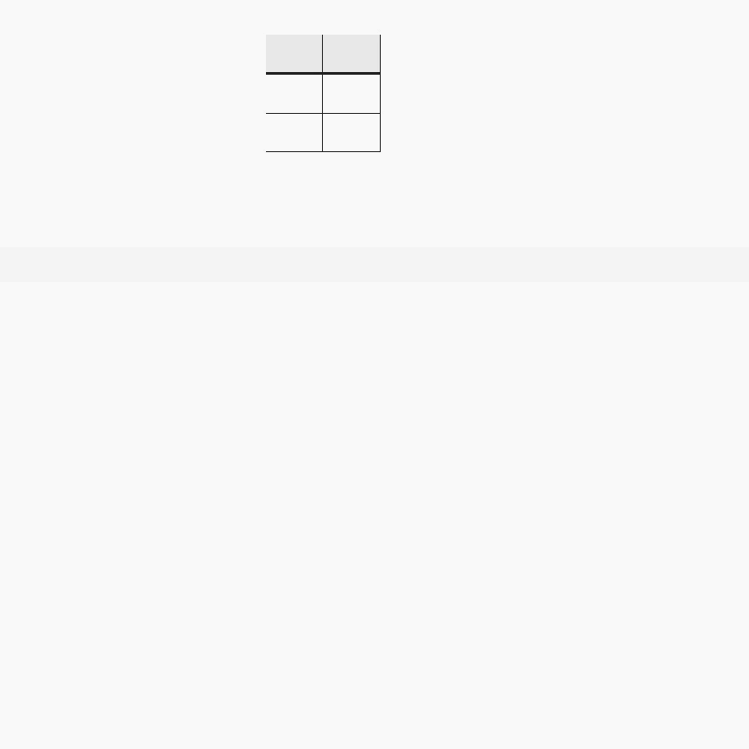

**17 · 状态栏** — 显示行列总数，选中范围时显示其大小和求和/平均值；拖拽分割线调整自带滚动条的占位宽度；⚙️ 视图设置可显示或隐藏（多 sheet 工作簿始终显示）；Shift+滚轮可横向滚动

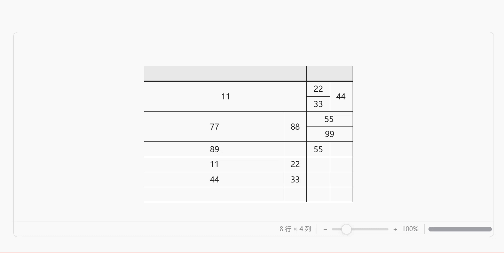

**18 · 行列转置** — 左侧控制列的翻转图标一键交换行列；列类型、公式、排序、视图无法跟随，会被丢弃

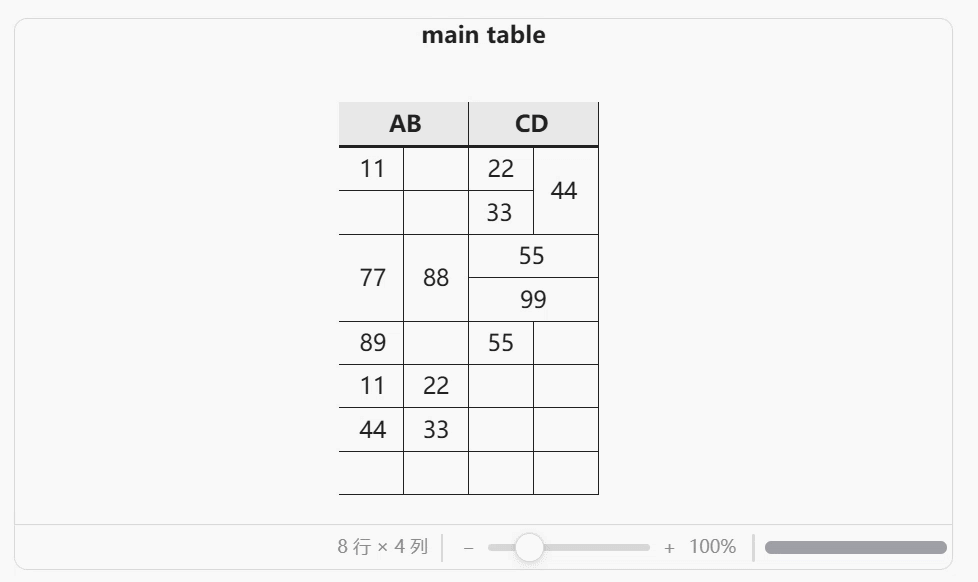

**19 · 嵌套表格** — 单元格内容本身可以是一个 rich-table 代码块，原地完整渲染并可交互编辑

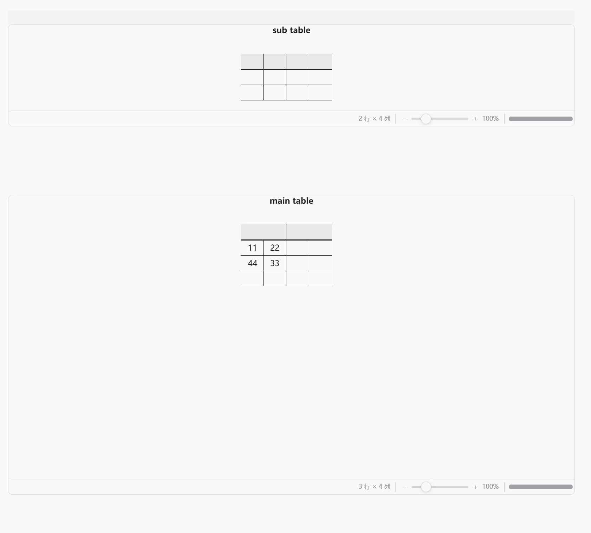

**20 · 全选** — 左侧控制列的网格图标一键选中所有单元格（包括表头），并弹出与拖拽全选相同的范围操作菜单。该菜单还可以**一键清空**所有选中单元格的内容

> 🎬 *演示 GIF 制作中*

**21 · 缩放** — 状态栏里仿 Excel 的 −/滑块/+ 控件，位于行列统计和滚动条之间；将整张表格——内容、图片、单元格尺寸——按 25%–400% 等比例缩放，随表格一起保存

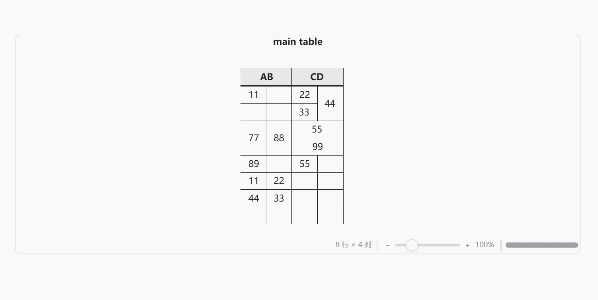

**22 · 引用外部excel文件** — 引用显示外部excel文件，支持多sheet，支持修改cell内容、合并状态

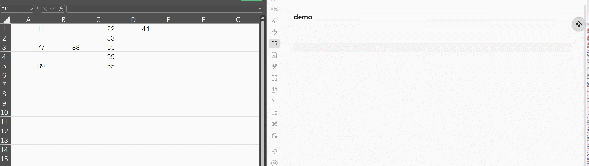

**23 · 自动填充** — 选中整行或整列，选择**自动填充…**：挑一种类型（数字、带圈数字 ①②③、罗马数字或日期），设置初始值和步长（日期的步长可按天、周、月、年），该行或列的每个单元格就会依次写入下一个值。结果就是普通的单元格文本，和手动输入完全一样——行列上不做任何标记，之后不会自动更新。隐藏和被筛掉的行同样占号，已有内容会被覆盖；带圈数字超过 ㊿、罗马数字超过 3999 的部分会改用阿拉伯数字写入并给出提示。

> 🎬 *演示 GIF 即将发布*

---

## 键盘操作


单元格有三种状态，下面所有快捷键都取决于当前处在哪一种。

**编辑态** —— 单元格里开着编辑器，单击进入的就是这个状态。

| 按键 | |
|------|--|
| `Esc` | 放弃本次编辑，该格转为**选中态**（与 Excel 一致，不写入任何内容） |
| `Enter` | 提交，该格转为**选中态** |
| `Tab` / `Shift`+`Tab` | 提交，并选中下一个 / 上一个单元格 |
| `←` `→` | 移动光标；光标已在首/尾字符时提交并选中左右相邻的单元格 |
| `↑` `↓` | 跳到本格内容的开头 / 末尾；已在开头/末尾时提交并选中上方 / 下方的单元格 |
| `Shift`+`Enter` | 在格内换行 |
| `Ctrl`+`A` | 选中正在编辑的单元格内的全部文字 |

**选中态** —— 单元格有高亮边框但没开编辑器，由上面的 `Esc` 或 `Enter` 进入。

| 按键 | |
|------|--|
| `←` `→` `↑` `↓` | 移动选中框。左右到行首尾会跨到相邻行；上下到表格边界则停住 |
| `Tab` / `Shift`+`Tab` | 等同 `→` / `←` |
| 任意字符 | 开始编辑，并用刚输入的字符替换原内容 |
| `Enter` | 开始编辑并保留原内容（内容为全选状态，按一个键即整体替换） |
| `Backspace` / `Delete` | 直接清空该格，不进入编辑态 |

补充：

- **表头参与导航** —— 从第一行数据行按 `↑` 即可到达；在表头输入即为重命名该列。
- **合并单元格**只会落在其锚点格，不会落进被它覆盖的位置；**隐藏行列与被筛掉的行**会自动跳过。
- **类型列**按各自类型响应：日期格打开原生选择器，此时方向键用于切换/增减年月日；选择格打开的是 Obsidian 自带的选项菜单，按 Obsidian 菜单的常规方式操作即可。两者都可用 `Tab` 提交并跳到下一格。

---

## 公式

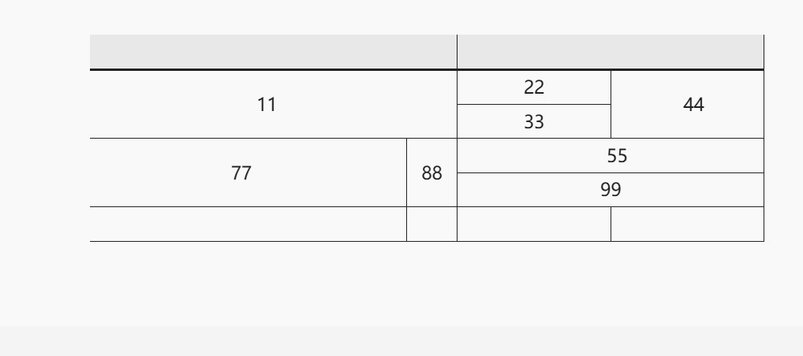

在普通单元格里输入 `=` 即可开始输入公式，与 Excel/Sheets 的习惯一致。支持四则运算（`+ - * /`，可加括号）和 `SUM`/`AVG`/`MIN`/`MAX`/`COUNT` 对一个范围求值。输入过程中点击另一个单元格即可插入引用，拖拽可插入一个范围，不需要手写单元格地址。

公式跟随被引用的行/列本身，不是位置，所以插入或调整行列顺序都不会破坏已有公式。被引用的行/列被删除会显示 `#REF!`；其他结果还有 `#CIRCULAR!`（自我引用）、`#DIV/0!`、`#VALUE!`。

---

## Claude Code Skill

仓库中附带了一个 [skill](skills/obsidian-rich-table/SKILL.md)，可与 [Claude Code](https://claude.ai/code) 等 AI 编程助手配合使用。安装后，agent 可以直接在 vault 中创建和修改 `rich-table` 块——添加行、设置样式、定义合并——无需记忆语法。

```bash
# 安装到全局（-g），目标为 Claude Code
npx skills add SdKay/obsidian-rich-table -g -a claude-code

# 之后更新到新版本
npx skills update
```

不加 `-g` 则只安装到当前项目。手动安装：把 `skills/obsidian-rich-table` 文件夹复制到 `~/.claude/skills/`。

之后告诉 Claude："在我的笔记里用 rich-table 创建一个项目看板"，它会自动生成对应的代码块。

技能里还附带一个命令行编辑工具 `scripts/rich-table.cjs`（只需 Node 18+，不依赖 Obsidian），任何工具或 agent 都可以用它修改表格，不必手写 YAML。它执行的就是插件内部的同一套操作——id 保持唯一、删除行列时连带清理合并和样式、公式自动重算——并且只改写笔记里选定的那一个代码块：

```bash
node scripts/rich-table.cjs list  note.md
node scripts/rich-table.cjs show  note.md --block 0
node scripts/rich-table.cjs apply note.md --block 0 --op '{"type":"insert-row","afterRowId":null}'
```

未知的操作，或表格里不存在的行/列 id，会被拒绝，且不会写入任何内容。

---

## 设置

打开 **设置 → Rich Table** 进行配置。

| 设置项 | 默认值 | 说明 |
|--------|--------|------|
| 阅读模式下允许编辑 | 关闭 | 关闭时，阅读模式下所有交互行为（hover 条带、单击编辑、双击面板、下拉选值）均被禁用。实时预览 / 源码模式不受影响。 |
| 单击进入编辑 | 关闭 | 开启后，单击单元格立即进入编辑（无延迟），样式面板改用 Ctrl/Cmd+单击打开（而非双击）。关闭时（默认）：单击延迟一小段时间后进入编辑，双击打开样式面板。 |
| 新建表格的默认主题 | 网格 | 新插入的空白表格，以及由 Markdown 表格转换而来的表格所使用的主题。选择*默认*表示不使用主题。内置模板保持自己的外观，任何表格仍可通过左侧工具栏单独切换主题。 |
| 单元格使用笔记编辑器（实验性） | 关闭 | 普通文本单元格改用 Obsidian 自带的编辑器，`[[` 双链、`==` 高亮颜色、`#标签` 和 `/` 命令的补全与笔记正文完全一致。依赖 Obsidian 的内部接口，Obsidian 更新后可能失效——不可用时会自动回退到内置编辑器。公式单元格，以及选中单元格后直接打字，仍使用内置编辑器。 |
| 单元格内边距 | 4 | 单元格内文字与上下边框的距离，单位 px（0 到 16）。阅读视图与编辑视图一致，修改后立即生效。 |
| 用 Rich Table 打开 .xlsx 文件 | 开启 | 在库中打开 `.xlsx` 文件时，在独立标签页中以只读表格显示。如果希望由其他插件打开 `.xlsx`，请关闭此项，修改立即生效。如果其他插件已经接管了 `.xlsx`，Rich Table 会让出并在此处提示。 |
| 左侧工具栏按钮 | 全部显示 | 分别为锁定表格、未锁定表格、引用外部 .xlsx 的表格独立隐藏任意左侧工具栏按钮（锁定、自动调整、主题、快照、导出……）——每个列表只会列出该场景下实际可用的按钮。 |
| 自定义类型 | — | 自定义带标签和颜色的选择列类型。 |
| 更新日志 | — | 随时打开完整的版本更新历史。插件更新后首次加载时也会自动弹出一次。 |

### 界面语言

界面语言跟随 Obsidian 的语言设置，支持：English、简体中文、Deutsch、Français、日本語、한국어，其他语言显示英文。德语、法语、日语、韩语的翻译为机器翻译，欢迎通过 PR 修正 `src/i18n/` 下对应的文件。内置模板和主题名称目前只有中英文版本，其他语言显示英文。

---

## 格式说明

````markdown
```rich-table
---
version: 2
title: 项目看板
columns:
  - id: c_000000
    name: 任务
    width: 200
  - id: c_000001
    name: 状态
    type: task-status
    width: 110
rows:
  - id: r_000000
    cells:
      c_000000: "**设计** — 架构评审"
      c_000001: done
  - id: r_000001
    cells:
      c_000000: 编码实现
      c_000001: pending
  - id: r_000002
    cells:
      c_000000: |-
        - 编写测试
        - 修复边界情况
      c_000001: todo
merges:
  - anchor: r_000000.c_000000
    end: r_000001.c_000000
styles:
  - target: header
    bold: true
    bg: "#e8f0fe"
  - target: r_000000.c_000001
    bg: "#f0fdf4"
footer: "每周更新 · 点击任意单元格即可编辑"
---
```
````

**单元格内容**支持完整 Obsidian Markdown：`**加粗**`、`*斜体*`、`[[双链]]`、`[链接](url)`、``、`- 列表项`、`$数学公式$`、`<br>` 换行。

编辑单元格时右键弹出 Obsidian 自带菜单（粘贴与 Ctrl+V 行为一致；以纯文本形式粘贴会把复制的表格原样放进单元格，不再铺开成多个单元格）。其中作用于笔记正文的编辑项作用对象是笔记而不是单元格，所以在单元格里被替换为作用于单元格文字的同款条目：**新增链接 / 新增外部链接**（把选区包成 `[[…]]` / `[…]()`）、**文本格式**（加粗、倾斜、删除线、高亮——默认或颜色：红、橙、黄、绿、蓝、紫——代码、数学、注释、清除格式；选区已带有该格式时条目会打勾）、**段落设置**（无序、有序、任务列表，1–6 级标题或正文，引用——对选中的每一行生效，空行也可用）和**插入**（标注、分隔线、代码块、数学块），顺序与 Obsidian 一致。再选一次已勾选的条目即取消。Ctrl+Shift+V 由 Obsidian 自己处理，会粘贴进正文而不是单元格。

**`width`/`height` 都是可选字段**——某一列/行没有 `width`/`height` 字段即为"auto"：渲染时按内容自动撑开宽高，且内容变化时持续跟随调整。拖拽调整手柄即固定为具体大小；双击手柄或点击"一键自适应"可恢复为 auto。

**样式 target**（v2 ID 格式）：

| 写法 | 含义 |
|------|------|
| `header` | 整个表头行 |
| `header.c_xxx` | 单个表头格 |
| `r_xxx` | 整行（数据行） |
| `c_xxx` | 整列（含表头） |
| `r_aaa:r_bbb` | 行范围 |
| `c_aaa:c_bbb` | 列范围 |
| `r_aaa.c_aaa:r_bbb.c_bbb` | 矩形范围 |
| `r_xxx.c_yyy` | 单个数据格 |

---

## 导出为 .xlsx

任何原生表格（使用代码块自身 `columns`/`rows`，不是引用外部文件——引用外部文件的情况见下面的[外部 .xlsx](#外部-xlsx)）都可以通过表格左侧工具栏那个带向上箭头的文件夹图标导出成一份真正的 `.xlsx` 文件。弹出的窗口里有两种互相独立的完成方式，任选一种：

- **Vault 内**——一个文件夹输入框（带 vault 内文件夹自动补全）和一个文件名（默认用表格自己的标题，没有标题就用笔记名），配一个自己的**导出**按钮。
- **自定义位置**（仅桌面端）——一个**选择位置…**按钮，会调出系统自己的保存对话框；在那里确认位置的那一刻就直接导出了，不需要再点第二次。这是 Electron 的一项能力，Obsidian 官方并未正式支持，属于尽力而为的便利功能——上面 vault 内的方式始终可用，移动端也只有这一种选择方式。

如果是多 sheet 的工作簿，会把每个 sheet 都导出进同一个文件，各自成为一个 xlsx 工作表。单元格内容、合并单元格、背景色/文字颜色、粗体/斜体、字号、列宽/行高都会带入导出的文件。在 Obsidian 里手动调整过大小的列/行会保留原样；没调整过的列/行会按内容（最长一行，中文按双倍宽度计算）估算出合适的宽度/高度，而不是套用 Excel 那种固定不变的默认值，这样打开文件时文字不会被裁切掩盖。笔记本身不会被改动——导出只会写入新的 `.xlsx` 文件。如果导出到一个已经存在的路径，会先询问是否覆盖。

## 外部 .xlsx

表格可以不使用代码块自身的 `columns`/`rows`，而是指向一份外部 `.xlsx` 文件——适合查看别人维护的表格，而不必把内容复制进笔记里：

````markdown
```rich-table
---
version: 2
xlsxSource:
  path: data/budget.xlsx
---
```
````

`path` 的解析方式跟 wikilink 目标一样（相对于当前笔记，或者写完整的 vault 路径）。`sheet` 是可选的——不填就把每个 sheet 都显示出来（如果文件只有一个 sheet 就直接显示那一个）；填了就只显示指定的那个 sheet。

最简单的创建方式：插入一个空的 `rich-table` 代码块，在模板按钮里点**从 .xlsx 导入**，选一个已经在 vault 里的文件。

**编辑单元格内容和合并会直接写回 `.xlsx` 文件本身**——不会写进笔记，笔记里始终只保存 `xlsxSource` 这个引用。点击单元格编辑文字（表头也一样）跟普通表格完全相同；拖拽选中一片区域后点**合并单元格**，或者双击/右键已有的合并区域选**取消合并**。其它操作（排序、样式、冻结、行列增删等）暂时都还是只读——这些操作直接不会出现在菜单里，不会出现点了没反应的情况。编辑时会尽量保留原有的值类型（数字类型的内容如果新文本还能解析成数字就继续存数字，布尔类型对应 `TRUE`/`FALSE` 同理，否则按 Excel 的"常规"格式自动识别）；开头是 `=` 会存成公式；清空内容会直接删除该单元格。如果文件保存失败（比如正被 Excel 占用打开），会弹出提示并把表格恢复成文件真实的（未变的）内容，不会留下一个看起来生效了但其实没保存的假象。

- **自动刷新**——用 Excel / LibreOffice 等工具改完存盘，大约半秒内表格就会更新，不需要手动刷新；插件自己的写入触发的也是同一套刷新机制。
- **跟踪改名**——把文件改名或挪动位置，代码块里的 `xlsxSource.path` 会自动同步更新。
- **删除处理**——文件被删掉之后，表格会显示错误提示，而不是悄悄停留在旧内容上。
- **用默认应用打开** 和 **转为普通表格**——表格左侧工具栏的两个按钮。前者把文件交给系统关联的默认程序打开（仅支持桌面端）；后者把文件当前的内容原样写进代码块自身的 `columns`/`rows`，并永久去掉 `xlsxSource` 引用——转换之后就是一张普通的、可完全编辑的 rich-table。
- **主题**——默认使用 `grid` 主题（没有可交互的切换按钮，因为主题切换还不在这种表格能编辑的范围内）；如果想用别的内置主题，在代码块自身的 YAML 里、`xlsxSource` 旁边加一行 `theme: <主题id>` 即可。

已知限制：没有并发控制（谁最后写入生效，跟直接改文件本身一样）；读取时主题色/索引色、单元格边框、数字格式不会还原；公式单元格只显示最后一次保存时的计算结果（没有公式引擎）；富文本按 run 分段的格式会被拍扁成纯文本；样式面板里背景色/文字颜色/字号/粗体/斜体对 xlsx 表格是隐藏的（能读不能写）。

### 直接打开 .xlsx 文件

在文件浏览器里点击 `.xlsx` 文件，会在标签页中以只读表格显示，不需要任何笔记。表格按内容大小显示，超出时在自身框内滚动；多 sheet 的工作簿会显示 sheet 标签。视图会跟随文件：在 Excel 里保存后约半秒内刷新，文件改名后依然保持同步。这个视图不能编辑文件；要编辑单元格，请按上文的方式在代码块中引用该文件。单元格里写的链接（如 `[[笔记]]`）和在笔记里一样可以点击打开，但鼠标悬停时不会显示预览。

如果希望由其他插件打开 `.xlsx`，在 **设置 → Rich Table → 用 Rich Table 打开 .xlsx 文件** 中关闭即可。

### 搜索

安装 Rich Search 插件后，在 `.xlsx` 文件里打开一条搜索结果，会跳到对应的 sheet 和单元格，并标出该 sheet 上所有匹配。搜索读取的是单元格的存储值：日期是序列号，公式是上次保存的结果，超过 20 万个单元格的工作簿不参与搜索。标记是按显示出来的文字匹配的，所以单元格值里带有 Markdown 语法时，可能搜得到却标不出来。

笔记中的表格同样可以被搜索，搜到的是表格显示的内容：公式按计算结果，工作簿按 sheet 分别搜索。打开一条结果会滚动到对应单元格，必要时切换到它所在的 sheet，且不会修改笔记；笔记中所有已打开的表格都会标出各自的匹配。你打开的那一处匹配以完整亮度加外框显示，其余匹配变暗。标记在搜索面板保留该搜索期间一直存在，颜色取自 Rich Search 中的设置。

---

## 主题

在 YAML 前置元数据中加入 `theme:` 字段即可应用内置主题：

```yaml
theme: academic   # 学术三线表风格——仅上/中/下三条横线，无竖线
theme: grid       # Excel 全边框风格——完整网格线，加粗外边框和表头分隔线
theme: plain      # 彩虹渐变表头 + 动态边框
```

| 主题 | 说明 |
|------|------|
| *(不填)* | 默认——无特殊样式 |
| `academic 📐` | 仿 LaTeX booktabs 风格：上线 / 中线 / 下线，无竖线，无单元格背景 |
| `grid 🔲` | 每个单元格都有网格线，外边框加粗，表头与数据之间的分隔线也加粗 |
| `plain 🙂` | 呼吸渐变表头、彩虹动态边框、光标辐射行高亮 |

主题只影响视觉效果，不影响数据和布局。

**不选主题也能快速微调：** 只想改个小细节（不想套完整主题）时，在 Obsidian 的 CSS snippet 里对 `.bt-render-root` 设置以下变量即可，不需要写任何选择器：

| 变量 | 控制内容 | 默认值 |
|------|---------|--------|
| `--bt-border-outer` | 表格外边框 | `none` |
| `--bt-cell-border`（及 `-right`/`-bottom`） | 单元格之间的网格线 | `none` |
| `--bt-cell-bg` | 数据单元格背景 | `transparent` |
| `--bt-header-bg` | 表头单元格背景 | 随主题默认值 |
> 每个单元格只画自己的**右边**和**下边**，网格最上和最左那条边由表格自身的 `--bt-border-outer` 提供。`--bt-cell-border-top`/`-left` 对网格线不再生效。

```css
.bt-render-root {
  --bt-header-bg: #223;
  --bt-cell-bg: #fafafa;
  --bt-border-outer: 2px solid #888;
}
```

通过样式面板手动设置的单元格样式，始终优先于主题和这些变量。

---

## 许可证

[AGPL-3.0](LICENSE)——衍生作品须以相同协议开源。

**商业授权**请联系：sdkxyx@gmail.com

---

## 致谢

.xlsx 的解析与写入基于 [@office-kit/xlsx](https://github.com/office-kit/xlsx) 开源库实现。

---

## 赞助支持
Rich Table 是完全免费开源的插件，采用 AGPL-3.0 协议开源。如果这个插件提升了你的笔记效率，欢迎通过自愿捐赠支持后续开发，你的支持是持续修复问题、新增功能、适配 Obsidian 新版本的最大动力。

### 🌍 PayPal
[](https://paypal.me/ssdking)

### 🧧 微信 / 支付宝
| 微信支付 | 支付宝 |
|:---:|:---:|
|  |  |

感谢支持！🙏

---

## 支持与反馈

问题反馈与功能建议：[GitHub Issues](https://github.com/SdKay/obsidian-rich-table/issues)

---

[](https://star-history.com/#SdKay/obsidian-rich-table&Date)

